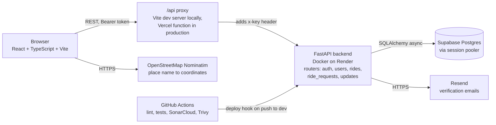

# Sprint 1

**Quick links**

| What | Where |
| --- | --- |
| Issues | [GitHub Issues](https://github.com/BisonRIdes/Comp4350Project/issues) |
| CI workflow | [`.github/workflows/ci.yml`](https://github.com/BisonRIdes/Comp4350Project/actions/workflows/ci.yml) |
| Code quality | [SonarCloud](https://sonarcloud.io/project/overview?id=BisonRIdes_Comp4350Project) |
| API spec | [`documents/openapi.yaml`](../documents/openapi.yaml) |
| Live API docs | https://bisonrides-api.onrender.com/docs |
| Architecture | [Architecture Diagram](../documents/ArchitectureDiagram.png) |
| Backend setup | [`backend/README.md`](../backend/README.md) |
| Frontend setup | [`Frontend/README.md`](../Frontend/README.md) |

## Sprint Summary

The main focus of sprint 1 was to implement the core user flow of Bison Rides for both drivers and riders. This core functionality allows both parties to use the application and get meaningful value out of it as a ride sharing app for commuting to campus.

First off, drivers are able to post rides for others to see, with those posts including important details like starting location and time. If their plans change or if they simply made a typo, drivers are able to update their posted rides to keep the ride's information accurate. In addition, drivers can also delete their rides if they're no longer planning on heading to campus. This ensures that anyone looking for a ride sees up-to-date information about what rides are available to them, allowing them to choose the one that best suits them in terms of their schedule and proximity.

If a rider finds a ride that works for them, they are able to create a request to join that ride. Drivers are then able to view these requests and can choose to either accept or decline them, giving them control over who they feel comfortable offering a ride to. Riders can then check the status of their requests to see whether they were accepted or declined. Additionally, if a rider is for some reason able to get to campus on their own, they are able to cancel their request if they so choose. This removes the request from the driver's list so they know they don't have to pick them up, and it also gives the rider flexibility so they're not locked into a ride they don't want anymore.

We also added student accounts. Only `@myumanitoba.ca` emails can sign up, each account is verified through a link sent by email, and users log in to get a token that the API uses to check who they are.

This full flow works through our backend API, which is live on Render. On the frontend, students can sign up, verify their email, log in, see upcoming rides on a dashboard, and post a ride. Pages for the rest of the flow (requesting a ride, accepting or declining, checking status, cancelling, and editing or deleting a ride) are not built yet (see Incomplete Features below). Alongside the features, we set up the CI/CD pipeline, automatic backend deployment, and an OpenAPI spec that the frontend and backend teams build against.

Overall, what we've implemented so far provides both the riders and drivers who use Bison Rides the core functionality of what we envision for our application, as well as providing us the opportunity to evaluate and iterate on the application's core functionality early on in development. This will help us ensure the core user flow feels good and gives us a solid foundation to build upon in future sprints.

The detailed record of completed work is on the sprint board and in the closed issues.

## Testing Status

**Approach**

- Backend tests use `pytest` with `pytest-asyncio` and FastAPI's `TestClient`.
- Most tests call each endpoint through the full backend (routing, validation, API key and login token, ORM) against a real SQLite test database. Each test gets a fresh database from an autouse fixture in [`backend/tests/conftest.py`](../backend/tests/conftest.py), and that fixture refuses to run against any database URL without "test" in it.
- Smaller tests cover the Pydantic schemas, the SQLAlchemy models and the login token helpers directly.
- Test settings come from [`backend/.env.test`](../backend/.env.test). Shared helpers for seeding users, rides and requests are in [`backend/tests/helpers.py`](../backend/tests/helpers.py).
- Mocking uses Python's built in `unittest.mock` (`AsyncMock`, `MagicMock`) and pytest's `monkeypatch`. The only outside service so far is Resend, so the email sender and its HTTP call are mocked. An autouse fixture also removes `RESEND_API_KEY`, so tests never send a real email.

**Current state (on `dev`)**

- 96 tests, all passing.
- 98% line coverage over all backend code except `tests/` (configured in [`backend/.coveragerc`](../backend/.coveragerc)).
- Every router (`auth`, `rides`, `ride_requests`, `updates`, `users`), every `util` module (auth, email, security, tokens), `models.py` and `schemas.py` are at 100%.
- The only uncovered lines are the Postgres connection string branch in `database.py` and the app lifespan setup in `main.py`.
- The frontend has no tests yet. CI lints it with oxlint and type checks it with `tsc` as part of the build.

**Acceptance criteria evidence**

Each piece of the Sprint 1 flow is checked by tests that go through the real endpoints. Each row lists the main behaviour checked and where the tests are.

| Story | What the tests check | Tests |
| --- | --- | --- |
| Student signs up | Only `@myumanitoba.ca` emails are accepted, emails are stored in lowercase, duplicate usernames or emails get `409` (including two sign ups at once), and a verification link is emailed | [`test_users.py`](../backend/tests/test_users.py) `test_create_account*` |
| Student verifies email and logs in | Login works only after verifying. Wrong passwords and unknown emails get the same `401`, so nobody can tell which emails have accounts. Expired, tampered or wrong purpose tokens are rejected. A new link can be sent | [`test_auth.py`](../backend/tests/test_auth.py), [`test_tokens.py`](../backend/tests/test_tokens.py) |
| Driver posts a ride | Only drivers can post. The driver comes from the login token, not the request body. Seats default to 1. Bad input gets `422` | [`test_rides.py`](../backend/tests/test_rides.py) `test_create_ride*` |
| Rider sees available rides | Rides are listed soonest first, and only for logged in users | [`test_rides.py`](../backend/tests/test_rides.py) `test_list_rides*` |
| Driver edits or deletes a ride | Only the ride's driver can change it. Edits only change the fields sent. Deleting removes pending requests but is blocked when a rider is already accepted | [`test_rides.py`](../backend/tests/test_rides.py) `test_edit_*`, `test_delete_*` |
| Rider requests a ride | Duplicate requests and requests on rides the rider is already on are rejected. The rider comes from the token | [`test_ride_requests.py`](../backend/tests/test_ride_requests.py) `test_create_ride_request*` |
| Driver accepts or declines | Only the ride's driver can answer, a rider can't accept their own request, and accepting is blocked once the ride is full | [`test_ride_requests.py`](../backend/tests/test_ride_requests.py) `test_accept_*`, `test_decline_*` |
| Rider cancels a request | Only the rider who made it can cancel. Cancelling an accepted request frees the seat and keeps the other riders | [`test_ride_requests.py`](../backend/tests/test_ride_requests.py) `test_cancel_*` |
| Rider sees request status | Drivers see only pending requests on their own rides. Riders see only their own accepted or declined requests | [`test_updates.py`](../backend/tests/test_updates.py) |

**What the coverage numbers mean**

High coverage here mostly reflects that every endpoint was written with tests in the same PR. We focused tests on the rules that matter for users: who is allowed to change what, and what happens in edge cases like full rides, duplicate requests and expired links. The two uncovered spots are startup code that only runs against the real Postgres database, so we left them out rather than test them against a fake. The bigger gaps are not visible in the number. The frontend has no automated tests, nothing tests the frontend and backend together, and tests run on SQLite instead of Postgres (see Known Issues).

Coverage is reported on every CI run and uploaded to [SonarCloud](https://sonarcloud.io/project/overview?id=BisonRIdes_Comp4350Project). To run the tests locally, see [Run the tests](../backend/README.md#run-the-tests).

## CI Status

Workflow: [`.github/workflows/ci.yml`](https://github.com/BisonRIdes/Comp4350Project/actions/workflows/ci.yml)

**Triggers:** every pull request into `dev` or `main`, and every push to `dev` or `main`.

**Jobs:**

| Job | What it does |
| --- | --- |
| `backend` | Installs dependencies on Python 3.12, runs `ruff check`, `ruff format --check`, `pytest` with coverage, then the SonarCloud scan. |
| `frontend` | `npm ci`, lint with oxlint, then `npm run build` (TypeScript check + Vite build). |
| `security` | Trivy file system scan for vulnerable dependencies, leaked secrets and misconfigurations. Fails the build on fixable HIGH or CRITICAL findings. |
| `deploy-backend` | Only on pushes to `dev`, and only after `backend` and `security` pass. Calls the Render deploy hook for that exact commit. |

Branch rules: issue branches come off `dev`, and every PR needs two reviews before merge (see [`sprint0.md`](sprint0.md#additional-process-or-protocol-documentation)).

**Planned next:**

- Frontend tests (unit and component tests) added to the `frontend` job.
- Automatic frontend deploys to Vercel, with preview URLs on PRs.
- A deploy path from `main` once we start merging `dev` into `main`.
- Turn on the SonarCloud quality gate as a required check for merging.

## API Documentation

- **Spec (source of truth):** [`documents/openapi.yaml`](../documents/openapi.yaml)
- **Live interactive docs:** https://bisonrides-api.onrender.com/docs. Click **Authorize** and enter the API key, plus a login token from `POST /auth/login`. The API key is shared with the instructor separately and is not stored in the repo.

Every request needs the `x-key` header. Every request except sign up and the `/auth` endpoints also needs a login token as `Authorization: Bearer <token>`.

Endpoints in Sprint 1:

| Area | Endpoints |
| --- | --- |
| Auth | `POST /auth/login`, `POST /auth/verify`, `POST /auth/resend-verification` |
| Users | `POST /users` (sign up), `GET /users/me` |
| Rides | `GET /rides`, `POST /rides`, `PATCH /rides/{ride_id}`, `DELETE /rides/{ride_id}` |
| Ride requests | `POST /rides/{ride_id}/requests`, `PATCH /requests/{request_id}/accept`, `PATCH /requests/{request_id}/decline`, `DELETE /requests/{request_id}/cancel` |
| Updates | `GET /updates` (pending requests on the caller's rides, and the caller's own accepted or declined requests) |

## Architecture

**Current system (Sprint 1)**

**Target design (Sprint 0)**

The Sprint 0 diagram is still where we are heading. What we built in Sprint 1 differs in a few places:

- **CI/CD.** CI runs on PRs and pushes to `dev` and `main`, not only on merge to `main`. Pushes to `dev` deploy the backend. Render builds the image from [`backend/Dockerfile`](../backend/Dockerfile), so there is no Docker Hub step.
- **API.** Endpoints are served from the root (for example `/rides`), not under `/api/v1`. There is no WebSocket connection yet.
- **Auth.** JWT login tokens as planned, plus a shared API key in the `x-key` header on every request.
- **Frontend to API.** The browser never holds the API key. Requests go to `/api` on the frontend's own domain, and a proxy adds the key and forwards them to Render. Locally that proxy is the Vite dev server. On Vercel it is a serverless function ([`Frontend/api/proxy.ts`](../Frontend/api/proxy.ts)).
- **Geocoding.** Typed place names are turned into coordinates with OpenStreetMap's Nominatim service, called from the browser. This was not in the Sprint 0 diagram.
- **Resend.** Only used for account verification emails so far.
- **Not built yet:** Redis cache, OpenRouteService, Stripe, and the Leaflet map.
- **Frontend hosting.** Set up for Vercel but not deployed yet.

## Deployment

| Part | Status |
| --- | --- |
| Backend | Live on Render: https://bisonrides-api.onrender.com (open [`/docs`](https://bisonrides-api.onrender.com/docs), other routes need the API key) |
| Database | Supabase Postgres, connected through the session pooler |
| Frontend | Not deployed yet. Set up for Vercel ([`Frontend/vercel.json`](../Frontend/vercel.json), [`Frontend/api/proxy.ts`](../Frontend/api/proxy.ts)). Runs locally on `http://localhost:5173`. |

Setup and run docs:

- Backend: [`backend/README.md`](../backend/README.md) covers local setup, running the server, tests and coverage, Docker, environment variables, and how to sign up, verify and log in (including how to get the verification link locally without a real inbox).
- Deployment notes: [`backend/README.md#deployment`](../backend/README.md#deployment) covers the Render setup, the Supabase pooler connection string, the API key, and the auth and email environment variables (`JWT_SECRET`, `RESEND_API_KEY`, `EMAIL_FROM`, `FRONTEND_URL`).
- Frontend: [`Frontend/README.md`](../Frontend/README.md) covers running it locally. Local settings go in `Frontend/.env.local` (see [`Frontend/.env.example`](../Frontend/.env.example)). On Vercel, the proxy needs `API_URL` and `API_KEY` set as environment variables.

**Secrets and configuration**

- Secrets (`API_KEY`, `JWT_SECRET`, `DATABASE_URL`, `RESEND_API_KEY`) live only in Render's and Vercel's environment variable settings. `.env` files are gitignored, and the committed `.env.example` files only hold placeholders.
- The API key never reaches the browser. The `/api` proxy adds it on the server side.
- The Trivy job in CI scans every PR and push for leaked secrets.
- Passwords are stored as salted scrypt hashes, never in plain text.

Note: Render's free tier sleeps when idle, so the first request can take up to about a minute.

## Reflection

**What is one commit, pull request, feature, or technical decision your team is particularly proud of, and why?**

- One technical decision we’re proud of is building our backend endpoints with unit tests written alongside them. Because we tested each endpoint as we built it, we caught bugs early and could make changes without worrying about breaking existing functionality. This gives us a solid foundation for Sprint 2, when more features will depend on these endpoints.

**What is one piece of work that could have been cleaner, easier to integrate, better tested, or otherwise improved, and why?**

- One area that could be improved is our test coverage. We only wrote unit tests this sprint, so we haven’t verified that the frontend and backend work correctly together. In Sprint 2, we plan to add integration and end-to-end tests for our main workflows so problems between components are caught before merging.

**How did testing fit into your workflow?**

- Our unit tests were written alongside the backend, during implementation rather than before or after. This helped in two ways: it saved time, which was limited because of everyone’s busy schedules, and it let us confirm as we went that new code wasn’t breaking existing functionality. This sprint we focused only on unit tests, since our main goal was to build robust backend endpoints that would give the project a strong foundation. Integration tests will come in later sprints, once more services need to communicate with each other. A more test-driven approach would likely have made this sprint harder in the short term. Our endpoints and data models were still changing as we figured out the design, so tests written first would have needed frequent rewrites, and that would have cost time we didn’t have. As our APIs become more stable, we could try writing tests first for new features in the next sprint.

## Known Issues

- **Deleting a ride with accepted riders.** Currently returns `409 Conflict`. The team has not decided the final rule yet (for example cancel the ride and email riders instead).
- **Updates feed returns all history.** `GET /updates` returns every accepted or declined request, including ones the rider has already seen. Whether to hide seen updates is still open.
- **Little application logging.** Only the email helper logs (failed sends, and the verification link when no Resend key is set). Everything else relies on uvicorn's default request log, so errors and failed requests are hard to trace on the live API. We plan to add logging across the backend.
- **No database migrations.** The app only creates missing tables and never changes existing ones. Adding `is_verified` to `users` needed a manual SQL change on Supabase (see [`backend/README.md`](../backend/README.md)). Changing `rides.departure_time` to store a timezone also needs a manual change on Supabase. Any future column change will need the same until migrations are set up.
- **Tests run on SQLite, production runs on Postgres.** Postgres specific behaviour, including any future PostGIS queries, is not covered by tests yet.
- **No frontend tests yet.** The frontend only gets lint and build checks.
- **`main` is behind `dev`.** All Sprint 1 work is on `dev`. `main` still holds the Sprint 0 files.

## Incomplete Features

Features that are started or planned but not finished on `dev`:

- **Ride request pages.** The backend supports requesting a ride, accepting or declining, checking status, cancelling, and editing or deleting a ride. The frontend does not have pages for these yet.
- **Post ride details.** The post ride page sends a place name and price, but the backend does not store them yet, so they are dropped.
- **Map and profile pages** are placeholders.
- **Ride email notifications (Resend).** Resend only sends verification emails. Emails about ride requests, accepts and declines are deferred to Sprint 2.
- **Later sprints:** ride matching by route and detour, the Leaflet map, routing with OpenRouteService, payments with Stripe, and the Redis cache.