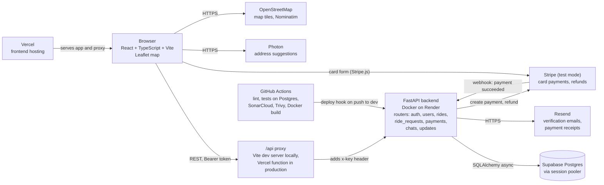

# Sprint 2

**Quick links**

| What | Where |
| --- | --- |
| Issues / sprint board | [GitHub Issues](https://github.com/BisonRIdes/Comp4350Project/issues) |
| CI/CD workflow | [`.github/workflows/ci.yml`](../.github/workflows/ci.yml) ([runs](https://github.com/BisonRIdes/Comp4350Project/actions/workflows/ci.yml)) |
| Recent CI run | [GitHub Actions run #44649239590](https://github.com/BisonRIdes/Comp4350Project/actions/runs/44649239590) |
| Code quality and coverage | [SonarCloud](https://sonarcloud.io/project/overview?id=BisonRIdes_Comp4350Project) |
| Regression testing notes | [`documents/tests.md`](tests.md) |
| API spec | [`documents/openapi.yaml`](openapi.yaml) |
| Live API docs | https://bisonrides-api.onrender.com/docs |
| Live app | [bisonrides.vercel.app](https://bisonrides.vercel.app) |
| Architecture | [Architecture section below](#api-and-architecture) |
| Backend setup | [`backend/README.md`](../backend/README.md) |
| Frontend setup | [`Frontend/README.md`](../Frontend/README.md) |

## Sprint Summary

In Sprint 1 the full ride flow worked through the API, but most of it had no pages. Sprint 2 put that flow in front of users and added the first features beyond the core loop.

**The ride flow now works end to end in the app.**

- Riders can open a ride, request a seat, and follow the request on the notifications page. Accepted seats show under "Your seats", and past requests are on the history page ([#91](https://github.com/BisonRIdes/Comp4350Project/pull/91), API layer in [#87](https://github.com/BisonRIdes/Comp4350Project/pull/87)).
- Drivers see pending requests in notifications and accept or decline them from there.
- Drivers can edit or delete their own rides from the app. Clicking your own ride on the dashboard opens the edit page. The backend blocks lowering seats below the number of accepted riders ([#84](https://github.com/BisonRIdes/Comp4350Project/pull/84)).
- The backend now returns full request details (who asked, who drives, when and where the ride leaves) and has `GET /requests/mine` and `GET /rides/{ride_id}` ([#78](https://github.com/BisonRIdes/Comp4350Project/pull/78)). Drivers can't request their own ride ([#74](https://github.com/BisonRIdes/Comp4350Project/pull/74)).

**New features.**

- **Payments (Stripe, test mode).** Once a request is accepted, the rider pays for the seat by card. The card goes straight to Stripe. The seat is only marked paid when Stripe's webhook confirms it, and a receipt is emailed through Resend. Cancelling a paid seat refunds it in full ([#75](https://github.com/BisonRIdes/Comp4350Project/pull/75)). For details on how to use payment see our [Stripe Documentation](../backend/README.md#payments-stripe-test-mode). As it would be inappropriate to request the graders to insert real credit information to grade our project, we are using a Stripe exclusively in test mode, and not storing credit info for the driver receiving a payment. This is something that would need to be updated if we wanted to deploy this for profit.
- **Map and address search.** Rides show on a  Leaflet map. The Map page lists upcoming rides next to a map. Address fields suggest real Manitoba addresses as you type (Photon), so a posted ride stores exact coordinates instead of a guess. Dashboard search can find rides that start within 5 km of a chosen address [issue #88](https://github.com/BisonRIdes/Comp4350Project/issues/88). Further addresses can be added by clicking on a map instead of typing in the address [#89](https://github.com/BisonRIdes/Comp4350Project/pull/89).
- **Detours (backend).** The backend functionality for handlind detours has been added. The frontend implementation for detours is built but does not yet include selecting a location using the map, and visualizing the detour in the map.
- **Chat** Riders and drivers on a ride can open a personal chat or a group chat for the ride and send and read messages. The API backend for chat messages can be found in [#92](https://github.com/BisonRIdes/Comp4350Project/pull/92). The frontend for chat message page can be found in [#103](https://github.com/BisonRIdes/Comp4350Project/pull/103).

**Sprint 1 feedback.** Signup now has standard password rules, error messages stand out in colour, and the signup form has a clearer student email field ([#71](https://github.com/BisonRIdes/Comp4350Project/pull/71)).

**Engineering.** Backend tests now run against real Postgres in a container instead of SQLite ([#79](https://github.com/BisonRIdes/Comp4350Project/pull/79)). CI builds the backend Docker image and checks that the app imports inside it before deploying. All tests are tagged as the regression suite [issue #80](https://github.com/BisonRIdes/Comp4350Project/issues/80).

The sprint board and closed issues remain the detailed record of completed work.

## Regression Testing

See: [`documents/tests.md`](tests.md)

## Testing Status and Gaps

**Coverage evidence:** Here is a coverage report: [report](https://github.com/BisonRIdes/Comp4350Project/actions/runs/44651807483/job/136008260992#step:8:34)

**What the report shows.** Overall coverage is 98%. Backend coverage stays high because each endpoint is still written with its tests in the same PR. The new code (payments, the Stripe wrapper, detours and chats) came with its own test files: [`test_payments.py`](../backend/tests/test_payments.py), [`test_stripe_api.py`](../backend/tests/test_stripe_api.py), [`test_chats.py`](../backend/tests/test_chats.py), plus new cases in [`test_rides.py`](../backend/tests/test_rides.py) and [`test_ride_requests.py`](../backend/tests/test_ride_requests.py). The number only covers the backend, so it says nothing about the frontend.

**Known gaps**

| Gap | Why it exists | Plan |
| --- | --- | --- |
| **The frontend has no automated tests.** The request, notifications, edit ride, payment and map pages are only checked by lint and the TypeScript build. | Sprint 2 time went into getting the pages built and connected. | Add component tests for the request and payment pages before final. |
| **Nothing tests the frontend and backend together.** If the backend changes what a request must contain, CI still passes as long as each side passes on its own. | Backend tests call the API directly. The frontend build doesn't call the API. | Add a few end to end tests for the main flow (post a ride, request it, accept, pay) or contract tests against `openapi.yaml`. |
| **Real Stripe is never called in tests.** Tests use a `FakeStripe` and fake keys. | Tests must not depend on Stripe being up or move money. | Keep the fakes in CI. Check the full payment flow by hand on the live app with test cards before each demo.|
## CI / CD Status

Workflow: [`.github/workflows/ci.yml`](../.github/workflows/ci.yml)

**Triggers:** every pull request into `dev` or `main`, and every push to `dev` or `main`. Only pushes to `dev` deploy.

| Job | What it does |
| --- | --- |
| `backend` | Installs dependencies on Python 3.12. Checks `requirements.lock` matches `requirements.txt` (the Docker image installs from the lock file with hashes). Runs `ruff check`, `ruff format --check`, `pytest` with coverage, then the SonarCloud scan. |
| `frontend` | `npm ci`, lint with oxlint, then `npm run build` (TypeScript check and Vite build, the same build Vercel runs). |
| `security` | Trivy scan of the repo for vulnerable dependencies, leaked secrets and misconfigurations. Fails on fixable HIGH or CRITICAL findings. |
| `docker` | Builds the backend image from [`backend/Dockerfile`](../backend/Dockerfile), the same image Render builds, and imports the app inside it. This catches a module the Dockerfile forgot to copy. |
| `deploy-backend` | Only on pushes to `dev`, and only after `backend`, `security` and `docker` pass. Calls Render's deploy hook for that exact commit. |

**Continuous deployment**

- **Backend (Render).** Merging into `dev` runs the checks above, then `deploy-backend` tells Render to build and deploy that commit. Render's own auto-deploy is off, so nothing reaches Render without passing CI. The job is tied to a GitHub `render` environment, so each deploy shows in the repo's Deployments list with a link to the live `/docs`.
- **Frontend (Vercel).** Vercel's Git integration builds and deploys the `Frontend` folder from `main` on every push.

**How we know a deploy worked or failed**

- If any check fails, the run is red on the Actions tab and `deploy-backend` is skipped, so the live app keeps the last good version.
- If Render rejects the deploy hook, `curl -f` fails and `deploy-backend` goes red.
- The build and start on Render's side show in the Render dashboard. Render keeps serving the previous version if the new one fails to start. After a deploy we open https://bisonrides-api.onrender.com/docs to check it is up.
- Vercel shows build status on the commit and the PR.

**Secrets and configuration**

- GitHub Actions secrets: `RENDER_DEPLOY_HOOK`, `SONAR_TOKEN`.
- Render environment variables: `DATABASE_URL`, `API_KEY`, `JWT_SECRET`, `RESEND_API_KEY`, `EMAIL_FROM`, `FRONTEND_URL`, `STRIPE_SECRET_KEY`, `STRIPE_WEBHOOK_SECRET`.
- Vercel environment variables: `API_URL` and `API_KEY` for the `/api` proxy, and `VITE_STRIPE_PUBLISHABLE_KEY`.
- No secrets are committed. `.env` files are gitignored, the `.env.example` files only hold placeholders, and Trivy scans every run for leaked secrets. Stripe only uses test keys.
- Every variable is described in [`backend/README.md`](../backend/README.md#setting-up-environment-variables) and [`Frontend/README.md`](../Frontend/README.md).

## Live Deployment

| Part | Where |
| --- | --- |
| App | [bisonrides.vercel.app](https://bisonrides.vercel.app) |
| API | https://bisonrides-api.onrender.com ([`/docs`](https://bisonrides-api.onrender.com/docs), other routes need the API key) |
| Database | Supabase Postgres, through the session pooler |

**Test accounts:** 

As receiving the email for account verification may take a few minutes, here are the credentials for two pre-verified account. Both are registered as riders and drivers.

Username: Grader\
Email: Grader@myumanitoba.ca\
Password: S3cret!P@ssword

Username: Grader2\
Email: Grader2@myumanitoba.ca\
Password: S3cret!P@ssword2

**Trying the main flow**

1. Log in as the driver and post a ride from the Post Ride page. Pick a starting address from the suggestions.
2. Log in as the rider, find the ride on the dashboard or the Map page, and request a seat.
3. Back as the driver, accept the request from Notifications.
4. As the rider, pay for the seat with Stripe's test card `4242 4242 4242 4242`, any future expiry date, any CVC and any postal code. No real money moves. More test cards are in [`backend/README.md`](../backend/README.md#payments-stripe-test-mode).

**Notes**

- Render's free tier sleeps when idle. The first request can take up to about a minute.
- Registration of a new account requires a link sent through an email. Receiving this email may take a few minutes.

## Cross-Team Testing

### Workflow: Accout Login/Creation
Account Login and Creation worked fine. 
It prevents you from creating an account with a non-umanitoba email and makes it clear that requires a student's email. It also had strong password security with clear feedback if your password didn't meet the security requirements. The email verification code also worked fine and arrived within a few seconds of creating an account.

### Workflow: Account Editing
When trying to edit my account, I was successfully brought to the page to do so. The UI was easy to understand and it was obvious what each field meant. However, one little issue found was that it takes refreshing the app in order to see the changes made to your account. Additionally during testing, while it says that the changes made were saved, some of the options (age, description, profile colour) don't appear to save correctly.

### Workflow: Creating Ride Request
The inputs on this page all worked as expected and would provide error messages if the input was incorrect, or if a required input was missing. However, it seems like ride requests can be created for places anywhere in Canada, even places no one would realistically get a ride from (Ex: Vancouver).

### Workflow: Creating Ride Offer
The UI for this workflow is very similar to that of creating a ride request which is nice for learnability. The addition of a checkbox for carpooling seems like a weird addition since the point of offering a ride is to share it with others in the first place. The text for this checkbox is also a little confusing since it seems to imply that the user filling out this form is looking for a ride.

### Additional Notes
On the map, it shows ride requests/offers made by the user among those of other users, with no obvious indication it belongs to them. If the user presses the message button on their own ride, it just says that it could not open the chat.

The frontend also shows a user an HTTP 401 error on the map if there session expires.

Upon logging in, the UI was clean and uncluttered, making it easy to tell which elements were what. The dashboard and message tabs provide informative messages when there is no content present in them. When the dashboard contains ride offers/requests, the edit and cancel functionality for each one work as expected. But if the user creates many ride offers/requests, the dashboard gets a bit cluttered and it becomes harder to find a specific offer/request since they all look very similar at a glance.

**Our suggestions to the other team.** 
- [issue #229](https://github.com/popcorn9499/future-problems/issues/229)
- [issue #230](https://github.com/popcorn9499/future-problems/issues/230)
- [issue #232](https://github.com/popcorn9499/future-problems/issues/232)

**Feedback on our project.** We received feedback from Team 5

| Feedback | Category | Our reasoning |
| --- | --- | --- |
| invalid URLs show blank white page | Accepted | This is an oversight on our end, and we should resolve it. We will close the [issue](https://github.com/BisonRIdes/Comp4350Project/issues/96) created by team 5 as soon as we fix this. We have added this issue to sprint 3.|
| some rides show no price | Accepted | This was due to rides not storing their price in iteration 1. We should add guardrails to prevent something like this happening again. We will close the [issue](https://github.com/BisonRIdes/Comp4350Project/issues/98) created by team 5 as soon as we fix this. We have added this issue to sprint 3.|
| No way to reset a forgotten password | Deferred | This is another valid criticism, but we have decided that this is not as critical to our MVP as progressing with the route handling, and so we have intentionally decided to defer it for now. If we have time we will resolve this [issue](https://github.com/BisonRIdes/Comp4350Project/issues/97) as well. We have added this issue to the Stretch milestone.|

## API and Architecture

**API documentation**

- **Spec (source of truth):** [`documents/openapi.yaml`](openapi.yaml)
- **Live interactive docs:** https://bisonrides-api.onrender.com/docs. Click **Authorize**, enter the API key and a login token from `POST /auth/login`. The API key is shared with the instructor separately.

Every request needs the `x-key` header. Every request except signup, the `/auth` endpoints and the Stripe webhook also needs `Authorization: Bearer <token>`.

| Area | Endpoints | New in Sprint 2 |
| --- | --- | --- |
| Auth | `POST /auth/login`, `POST /auth/verify`, `POST /auth/resend-verification` | |
| Users | `POST /users`, `GET /users/me` | |
| Rides | `GET /rides`, `GET /rides/{ride_id}`, `POST /rides`, `PATCH /rides/{ride_id}`, `DELETE /rides/{ride_id}`, `GET /rides/{ride_id}/detours` | `GET /rides/{ride_id}`, detours |
| Ride requests | `POST /rides/{ride_id}/requests` (now takes a `detour_point`), `GET /requests/mine`, `PATCH /requests/{request_id}/accept`, `PATCH /requests/{request_id}/decline`, `DELETE /requests/{request_id}/cancel` (refunds a paid seat) | `GET /requests/mine`, pickup point |
| Payments | `POST /requests/{request_id}/payment`, `GET /requests/{request_id}/payment`, `POST /payments/webhook` (called by Stripe) | All |
| Chats | `POST /rides/{ride_id}/chats/personal`, `POST /rides/{ride_id}/chats/group`, `GET /chats`, `GET /chats/{chat_id}/messages`, `POST /chats/{chat_id}/messages` | All |
| Updates | `GET /updates` (now includes full request details) | Details |

**Architecture (current)**

Changes since Sprint 1:

- **Stripe** is new. The browser sends the card straight to Stripe, so card details never reach our servers. Stripe calls the backend's webhook directly (not through the `/api` proxy, which drops the `Stripe-Signature` header).
- **Resend** now also sends payment receipts.
- **Leaflet and Photon** are new. Maps use OpenStreetMap tiles. Address suggestions come from Photon because Nominatim's rules don't allow search as you type.
- **Chats and detours** add new tables (`chats`, chat messages, `ride_detours`) in the same Postgres database.
- **CI** now runs tests on Postgres and builds the Docker image before any deploy.
- Still not built from the Sprint 0 design ([`ArchitectureDiagram.png`](ArchitectureDiagram.png)): Redis cache, OpenRouteService routing, and real time chat over WebSockets.

## Reflection

**Individual contributions** (each member picks one prompt)

**Prithvi** (What feedback from Sprint 1 did the team act on, and what changed as a result?)\
After the Sprint 1 demo we were told signup only required 8 characters for a password, error messages were easy to miss, and drivers had no way to get to their own rides from the dashboard. We added standard password rules on signup, made error messages stand out in colour ([#71](https://github.com/BisonRIdes/Comp4350Project/pull/71)), and kept a driver's own rides in the list so clicking one opens the edit page ([#84](https://github.com/BisonRIdes/Comp4350Project/pull/84)). Building the edit page also made us decide a rule we had left open. The backend now blocks lowering a ride's seats below the number of riders already accepted, so an edit can't silently push someone off a ride.

**Alon** (prompt: What is the most important technical risk or uncertainty going into the final iteration?)\
I am uncertain if we decided on the right platform to deploy our backend onto. The Render resource limits on the free plan are very low, and as our backend has grown I am becoming concerned that this will become very apparent as our backend has grown and we begin load testing it.

**Raj** (prompt: TODO)
TODO

**Cam** (prompt: What part of the current testing, CI, or CD process creates the most friction, and what might improve it?)\
When I was working with the messages UI, I noticed that on backend we have already had extensive testing for database queries and API calls, but currently we do not have any end-to-end or automated UI testing for our frontend. This ultimately hampered frontend testing as we had to rely on manual testing to verify the workflow and catch any bug or issues that hamper user experience. This is evident by the absurd number of commits I pushed in [#95](https://github.com/BisonRIdes/Comp4350Project/pull/95) to fix the UI bugs that we found out only after CI/CD process and automated testing had finished without stopping. One way we can improve it in our next iteration is by having end-to-end testing tools integrated for our frontend side like in backend (backend refuses deployment if even a single unit test fails).

**Matt** (What is the most important technical risk or uncertainty going into the final iteration?)
I think the biggest technical risk we have is that we don't test the backend and frontend together, nor do we have automated tests for the frontend itself. As our project grows in complexity, I think it would be in our best interest to increase our number of tests and test variety so we can be confident our system is working correctly by the end of the final iteration.

**Shiv** (What technical decision or implementation improved most since Sprint 1, and why?)

The biggest improvement since Sprint 1 is the ride request workflow between riders and drivers. In Sprint 1 the backend supported requests, but the frontend had no screens for them and requests only carried IDs. Now a rider can request a seat, the driver is notified and accepts or declines, and the rider is notified and can pay, cancel or leave, all without reloading. The key decision was to let the backend own the facts: request details (names, ride time and place), seats left and the driver's name are computed in the backend, and full rides are rejected there, so every screen shows the same, correct data. On the frontend, a single shared poll feeds the notification badge, the Notifications page and My seats, and a layered structure.

**Shreshth** (What technical decision or implementation improved most since Sprint 1, and why?)\
The biggest improvement was to add auto complete for address and adding map to select a pickup/start location. In Sprint 1, Post Ride sent whatever text the driver typed to Nominatim and took the first Manitoba match. So "Regent" or a misspelled street could quietly save the wrong coordinates, and the driver never saw where it landed. In sprint 2, a user when starts entering an address a suggestion list is shown from where they can pick an address or select the location on map or if they allow location access we can check their live locaation. Adding maps also meant adding Leaflet, which is a large library, so we lazy-load it. The map code is a separate chunk that the browser only downloads the first time a map is shown, with a grey placeholder until it arrives. 

**Work we are proud of**

- **Leaflet Embedded Map ([#89](https://github.com/BisonRIdes/Comp4350Project/pull/89)).** Using the map for viewing and selecting rides was a core feature from the initial design discussions, so getting this done in this sprint was a huge milestone and is our most visible feature.
- **Testing on real Postgres ([#79](https://github.com/BisonRIdes/Comp4350Project/pull/79)).** Sprint 1's biggest testing gap was that tests used SQLite while production used Postgres. Each test run now starts a throwaway Postgres container, so the whole regression suite runs against the same database we deploy on.

## Known Issues and Risks for Final

- **No rate limiting.** Render does not include rate limiting, and so bad actors could easily flood the backend with expensive requests.
- **No frontend or end to end tests.** This is the biggest risk. Most new Sprint 2 work is in the frontend, and a change to an API contract can break a page without failing CI.
- **No database migrations.** The app only creates missing tables. New columns (for example `detour_point` on ride requests) need a manual `ALTER TABLE` on Supabase. This gets riskier as the schema grows.
- **Rides can only go to campus.** There is no destination field yet. The frontend assumes every ride ends at Fort Garry.
- **Detour matching is basic.** Riders can request the driver take a detour, but this detour is not visualized on the map for the ride.
- **Chats UI still looks clunky.** Chat workflow works, but there are still issues that hinder the user experience such as no ride name, chat behaviour is not as expected on frontend side.
- **Deleting a ride with accepted riders** still returns `409`. The final rule (cancel and email riders, or a cancelled status) is still open.
- **Render builds `dev` not `main`.** This has been convenient while developing, but warrants two separate environments to be more complete.
- **Little logging.** Errors on the live API are hard to trace beyond Render's request log, and should receive more comprehensive logging.
- **Render free tier** sleeps when idle, which also delays Stripe webhooks until it wakes (Stripe retries).

Docker Hub publishing, profiling, load testing and deployment hardening are planned for the final iteration.
