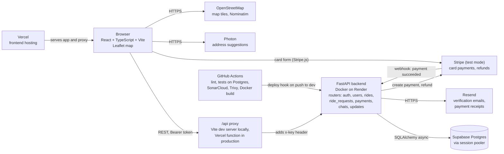

# Sprint 2

**Quick links**

| What | Where |
| --- | --- |
| Issues / sprint board | [GitHub Issues](https://github.com/BisonRIdes/Comp4350Project/issues) |
| CI/CD workflow | [`.github/workflows/ci.yml`](../.github/workflows/ci.yml) ([runs](https://github.com/BisonRIdes/Comp4350Project/actions/workflows/ci.yml)) |
| Recent CI run on `dev` | TODO: link the latest green run on `dev` |
| Code quality and coverage | [SonarCloud](https://sonarcloud.io/project/overview?id=BisonRIdes_Comp4350Project) |
| Regression testing notes | [`documents/tests.md`](tests.md) |
| API spec | [`documents/openapi.yaml`](openapi.yaml) |
| Live API docs | https://bisonrides-api.onrender.com/docs |
| Live app | [bisonrides.vercel.app](https://bisonrides.vercel.app) |
| Architecture | [Architecture section below](#api-and-architecture) |
| Backend setup | [`backend/README.md`](../backend/README.md) |
| Frontend setup | [`Frontend/README.md`](../Frontend/README.md) |
| Cross-team review we wrote | TODO: link |

## Sprint Summary

In Sprint 1 the full ride flow worked through the API, but most of it had no pages. Sprint 2 put that flow in front of users and added the first features beyond the core loop.

**The ride flow now works end to end in the app.**

- Riders can open a ride, request a seat, and follow the request on the notifications page. Accepted seats show under "Your seats", and past requests are on the history page ([#91](https://github.com/BisonRIdes/Comp4350Project/pull/91), API layer in [#87](https://github.com/BisonRIdes/Comp4350Project/pull/87)).
- Drivers see pending requests in notifications and accept or decline them from there.
- Drivers can edit or delete their own rides from the app. Clicking your own ride on the dashboard opens the edit page. The backend blocks lowering seats below the number of accepted riders ([#84](https://github.com/BisonRIdes/Comp4350Project/pull/84)).
- The backend now returns full request details (who asked, who drives, when and where the ride leaves) and has `GET /requests/mine` and `GET /rides/{ride_id}` ([#78](https://github.com/BisonRIdes/Comp4350Project/pull/78)). Drivers can't request their own ride ([#74](https://github.com/BisonRIdes/Comp4350Project/pull/74)).

**New features.**

- **Payments (Stripe, test mode).** Once a request is accepted, the rider pays for the seat by card. The card goes straight to Stripe. The seat is only marked paid when Stripe's webhook confirms it, and a receipt is emailed through Resend. Cancelling a paid seat refunds it in full ([#75](https://github.com/BisonRIdes/Comp4350Project/pull/75)).
- **Map and address search.** Rides show on a Leaflet map. The Map page lists upcoming rides next to a map. Address fields suggest real Manitoba addresses as you type (Photon), so a posted ride stores exact coordinates instead of a guess. Dashboard search can find rides that start within 5 km of a chosen address (issue #88).
- **Detours.** A rider's request now carries the point where they want to be picked up. When the driver accepts, that point is saved as a detour on the ride. `GET /rides/{ride_id}/detours` returns a ride's pickup points ordered from furthest to closest to campus (issue #82).
- **Chats (backend).** Riders and drivers on a ride can open a personal chat or a group chat for the ride and send and read messages (issue #76). The frontend for chats is not built yet.

**Sprint 1 feedback.** Signup now has standard password rules, error messages stand out in colour, and the signup form has a clearer student email field ([#71](https://github.com/BisonRIdes/Comp4350Project/pull/71)).

**Engineering.** Backend tests now run against real Postgres in a container instead of SQLite ([#79](https://github.com/BisonRIdes/Comp4350Project/pull/79)). CI builds the backend Docker image and checks that the app imports inside it before deploying. All tests are tagged as the regression suite (issue #80).

The sprint board and closed issues remain the detailed record of completed work.

## Regression Testing

Full notes: [`documents/tests.md`](tests.md)

| Question | Answer |
| --- | --- |
| What runs | Every backend test in [`backend/tests/`](../backend/tests/). That is unit tests (schemas, models, tokens, the Stripe and email helpers) and integration tests that send real requests through FastAPI's `TestClient` to a Postgres database. About 170 tests in total. TODO: confirm the exact count from the CI run. |
| How tests were selected | We run the full suite. It is fast enough to run on every change, and a smaller set would only save seconds while risking a missed bug. Each test file is tagged `@pytest.mark.regression` (marker defined in [`backend/pytest.ini`](../backend/pytest.ini)), so if the suite gets slow we can narrow regression runs by moving the tag instead of changing CI. |
| When it runs | On every pull request into `dev` or `main`, and on every push to `dev` or `main`. |
| Tools | GitHub Actions runs it. `pytest` with `pytest-asyncio` and `pytest-cov` executes it. `testcontainers` starts a throwaway `postgres:16-alpine` database for the run. Stripe and Resend are replaced with fakes, so tests never charge a card or send an email. |
| How long it takes | TODO: fill in from the CI run. Roughly under a minute for the tests plus a few seconds to start the Postgres container. The whole `backend` job, including install and the SonarCloud scan, takes TODO minutes. |
| What happens on failure | The `backend` check on the PR goes red and the PR shouldn't be merged until it is fixed. On a push to `dev`, a failing `backend` job also stops the deploy, because `deploy-backend` only runs after `backend`, `security` and `docker` pass. TODO: say whether branch protection makes the check required for merging. |
| Evidence | Workflow: [`ci.yml`](../.github/workflows/ci.yml). Recent run: TODO link. |

Why Postgres matters for regression: in Sprint 1 tests ran on SQLite while production ran on Postgres, so database differences could slip through. Running tests on the same database as production closes that gap.

## Testing Status and Gaps

**Coverage evidence:** TODO: add a screenshot of the `pytest --cov` output from the CI run, or link the SonarCloud coverage page.

**What the report shows.** TODO: add the overall line coverage number. Backend coverage stays high because each endpoint is still written with its tests in the same PR. The new code (payments, the Stripe wrapper, detours and chats) came with its own test files: [`test_payments.py`](../backend/tests/test_payments.py), [`test_stripe_api.py`](../backend/tests/test_stripe_api.py), [`test_chats.py`](../backend/tests/test_chats.py), plus new cases in [`test_rides.py`](../backend/tests/test_rides.py) and [`test_ride_requests.py`](../backend/tests/test_ride_requests.py). The number only covers the backend, so it says nothing about the frontend.

**Known gaps**

| Gap | Why it exists | Plan |
| --- | --- | --- |
| **The frontend has no automated tests.** The request, notifications, edit ride, payment and map pages are only checked by lint and the TypeScript build. | Sprint 2 time went into getting the pages built and connected. | Add component tests for the request and payment pages before final. |
| **Nothing tests the frontend and backend together.** If the backend changes what a request must contain, CI still passes as long as each side passes on its own. | Backend tests call the API directly. The frontend build doesn't call the API. | Add a few end to end tests for the main flow (post a ride, request it, accept, pay) or contract tests against `openapi.yaml`. |
| **Real Stripe is never called in tests.** Tests use a `FakeStripe` and fake keys. | Tests must not depend on Stripe being up or move money. | Keep the fakes in CI. Check the full payment flow by hand on the live app with test cards before each demo. |
| **Detour ordering is only lightly tested.** Tests check that pickup points come back in the right order, but the distance is a straight line on raw coordinates, not a road distance. | It is a first version of matching. Real routing (OpenRouteService) is not set up yet. | Revisit when routing is added. |
| **Chats only have backend tests.** There is no chat UI yet, so nothing checks how messages show up for users. | Chat backend was built first. | Covered once the chat pages exist. |

## CI / CD Status

Workflow: [`.github/workflows/ci.yml`](../.github/workflows/ci.yml)

**Triggers:** every pull request into `dev` or `main`, and every push to `dev` or `main`. Only pushes to `dev` deploy.

| Job | What it does |
| --- | --- |
| `backend` | Installs dependencies on Python 3.12. Checks `requirements.lock` matches `requirements.txt` (the Docker image installs from the lock file with hashes). Runs `ruff check`, `ruff format --check`, `pytest` with coverage, then the SonarCloud scan. |
| `frontend` | `npm ci`, lint with oxlint, then `npm run build` (TypeScript check and Vite build, the same build Vercel runs). |
| `security` | Trivy scan of the repo for vulnerable dependencies, leaked secrets and misconfigurations. Fails on fixable HIGH or CRITICAL findings. |
| `docker` | Builds the backend image from [`backend/Dockerfile`](../backend/Dockerfile), the same image Render builds, and imports the app inside it. This catches a module the Dockerfile forgot to copy. |
| `deploy-backend` | Only on pushes to `dev`, and only after `backend`, `security` and `docker` pass. Calls Render's deploy hook for that exact commit. |

**Continuous deployment**

- **Backend (Render).** Merging into `dev` runs the checks above, then `deploy-backend` tells Render to build and deploy that commit. Render's own auto-deploy is off, so nothing reaches Render without passing CI. The job is tied to a GitHub `render` environment, so each deploy shows in the repo's Deployments list with a link to the live `/docs`.
- **Frontend (Vercel).** Vercel's Git integration builds and deploys the `Frontend` folder on every push. TODO: confirm which branch Vercel uses for production (`dev` or `main`). PRs get Vercel preview builds.

**How we know a deploy worked or failed**

- If any check fails, the run is red on the Actions tab and `deploy-backend` is skipped, so the live app keeps the last good version.
- If Render rejects the deploy hook, `curl -f` fails and `deploy-backend` goes red.
- The build and start on Render's side show in the Render dashboard. Render keeps serving the previous version if the new one fails to start. After a deploy we open https://bisonrides-api.onrender.com/docs to check it is up.
- Vercel shows build status on the commit and the PR.

**Secrets and configuration**

- GitHub Actions secrets: `RENDER_DEPLOY_HOOK`, `SONAR_TOKEN`.
- Render environment variables: `DATABASE_URL`, `API_KEY`, `JWT_SECRET`, `RESEND_API_KEY`, `EMAIL_FROM`, `FRONTEND_URL`, `STRIPE_SECRET_KEY`, `STRIPE_WEBHOOK_SECRET`.
- Vercel environment variables: `API_URL` and `API_KEY` for the `/api` proxy, and `VITE_STRIPE_PUBLISHABLE_KEY`.
- No secrets are committed. `.env` files are gitignored, the `.env.example` files only hold placeholders, and Trivy scans every run for leaked secrets. Stripe only uses test keys.
- Every variable is described in [`backend/README.md`](../backend/README.md#setting-up-environment-variables) and [`Frontend/README.md`](../Frontend/README.md).

## Live Deployment

| Part | Where |
| --- | --- |
| App | [bisonrides.vercel.app](https://bisonrides.vercel.app) |
| API | https://bisonrides-api.onrender.com ([`/docs`](https://bisonrides-api.onrender.com/docs), other routes need the API key) |
| Database | Supabase Postgres, through the session pooler |

**Test accounts:** TODO: add a test driver and a test rider account (email and password) shared with the instructor, or say how they are shared.

**Trying the main flow**

1. Log in as the driver and post a ride from the Post Ride page. Pick a starting address from the suggestions.
2. Log in as the rider, find the ride on the dashboard or the Map page, and request a seat.
3. Back as the driver, accept the request from Notifications.
4. As the rider, pay for the seat with Stripe's test card `4242 4242 4242 4242`, any future expiry date, any CVC and any postal code. No real money moves. More test cards are in [`backend/README.md`](../backend/README.md#payments-stripe-test-mode).

**Notes**

- Render's free tier sleeps when idle. The first request can take up to about a minute.
- TODO: say whether new signups get their verification email on the live app, or still need the link from the Render logs.

## Cross-Team Testing

**Our review of another team.** TODO: link our review of Team ___ (workflows tried, bugs found, what worked well, suggestions).

**Feedback on our project.** We received feedback from Team ___ (TODO: link). We sorted each item as accepted, deferred or rejected.

| Feedback | Category | Our reasoning |
| --- | --- | --- |
| TODO | Accepted | TODO: what we changed or opened an issue for (link the issue). |
| TODO | Deferred | TODO: why it waits until final. |
| TODO | Rejected | TODO: why we won't act on it. |

At least two different categories are required.

## API and Architecture

**API documentation**

- **Spec (source of truth):** [`documents/openapi.yaml`](openapi.yaml)
- **Live interactive docs:** https://bisonrides-api.onrender.com/docs. Click **Authorize**, enter the API key and a login token from `POST /auth/login`. The API key is shared with the instructor separately.

Every request needs the `x-key` header. Every request except signup, the `/auth` endpoints and the Stripe webhook also needs `Authorization: Bearer <token>`.

| Area | Endpoints | New in Sprint 2 |
| --- | --- | --- |
| Auth | `POST /auth/login`, `POST /auth/verify`, `POST /auth/resend-verification` | |
| Users | `POST /users`, `GET /users/me` | |
| Rides | `GET /rides`, `GET /rides/{ride_id}`, `POST /rides`, `PATCH /rides/{ride_id}`, `DELETE /rides/{ride_id}`, `GET /rides/{ride_id}/detours` | `GET /rides/{ride_id}`, detours |
| Ride requests | `POST /rides/{ride_id}/requests` (now takes a `detour_point`), `GET /requests/mine`, `PATCH /requests/{request_id}/accept`, `PATCH /requests/{request_id}/decline`, `DELETE /requests/{request_id}/cancel` (refunds a paid seat) | `GET /requests/mine`, pickup point |
| Payments | `POST /requests/{request_id}/payment`, `GET /requests/{request_id}/payment`, `POST /payments/webhook` (called by Stripe) | All |
| Chats | `POST /rides/{ride_id}/chats/personal`, `POST /rides/{ride_id}/chats/group`, `GET /chats`, `GET /chats/{chat_id}/messages`, `POST /chats/{chat_id}/messages` | All |
| Updates | `GET /updates` (now includes full request details) | Details |

**Architecture (current)**

Changes since Sprint 1:

- **Stripe** is new. The browser sends the card straight to Stripe, so card details never reach our servers. Stripe calls the backend's webhook directly (not through the `/api` proxy, which drops the `Stripe-Signature` header).
- **Resend** now also sends payment receipts.
- **Leaflet and Photon** are new. Maps use OpenStreetMap tiles. Address suggestions come from Photon because Nominatim's rules don't allow search as you type.
- **Chats and detours** add new tables (`chats`, chat messages, `ride_detours`) in the same Postgres database.
- **CI** now runs tests on Postgres and builds the Docker image before any deploy.
- Still not built from the Sprint 0 design ([`ArchitectureDiagram.png`](ArchitectureDiagram.png)): Redis cache, OpenRouteService routing, and real time chat over WebSockets.

## Reflection

**Individual contributions** (each member picks one prompt)

**Prithvi** (What feedback from Sprint 1 did the team act on, and what changed as a result?)
After the Sprint 1 demo we were told signup only required 8 characters for a password, error messages were easy to miss, and drivers had no way to get to their own rides from the dashboard. We added standard password rules on signup, made error messages stand out in colour ([#71](https://github.com/BisonRIdes/Comp4350Project/pull/71)), and kept a driver's own rides in the list so clicking one opens the edit page ([#84](https://github.com/BisonRIdes/Comp4350Project/pull/84)). Building the edit page also made us decide a rule we had left open. The backend now blocks lowering a ride's seats below the number of riders already accepted, so an edit can't silently push someone off a ride.

**Alon** (prompt: TODO)
TODO

**Raj** (prompt: TODO)
TODO

**Cam** (prompt: TODO)
TODO

**Matt** (prompt: TODO)
TODO

**Shiv** (prompt: TODO)
TODO

**Shrey** (prompt: TODO)
TODO

**Work we are proud of**

- **Stripe payments ([#75](https://github.com/BisonRIdes/Comp4350Project/pull/75)).** Payments are easy to get wrong. A seat is only marked paid when Stripe's signed webhook says so, not when the browser says so. Card details never touch our servers. Cancelling refunds the rider. All of it is tested against a fake Stripe, so CI never depends on Stripe being up.
- **Testing on real Postgres ([#79](https://github.com/BisonRIdes/Comp4350Project/pull/79)).** Sprint 1's biggest testing gap was that tests used SQLite while production used Postgres. Each test run now starts a throwaway Postgres container, so the whole regression suite runs against the same database we deploy on.

## Known Issues and Risks for Final

- **No frontend or end to end tests.** This is the biggest risk. Most new Sprint 2 work is in the frontend, and a change to an API contract can break a page without failing CI.
- **No database migrations.** The app only creates missing tables. New columns (for example `detour_point` on ride requests) need a manual `ALTER TABLE` on Supabase. This gets riskier as the schema grows.
- **Ride start addresses aren't saved.** The frontend sends `origin_label`, but the backend ignores it, so ride cards look the place name up again in each browser. Steps to fix are in [`Frontend/README.md`](../Frontend/README.md).
- **Rides can only go to campus.** There is no destination field yet. The frontend assumes every ride ends at Fort Garry.
- **Detour matching is basic.** Pickup points are ordered by straight-line distance, not by real driving routes.
- **Chats have no UI.** The backend is done, but users can't chat yet.
- **Deleting a ride with accepted riders** still returns `409`. The final rule (cancel and email riders, or a cancelled status) is still open.
- **`main` is behind `dev`.** All work is merged into `dev` and deploys from there. We plan to promote to `main` for the final release.
- **Little logging.** Errors on the live API are hard to trace beyond Render's request log.
- **Render free tier** sleeps when idle, which also delays Stripe webhooks until it wakes (Stripe retries).

Docker Hub publishing, profiling, load testing and deployment hardening are planned for the final iteration.
